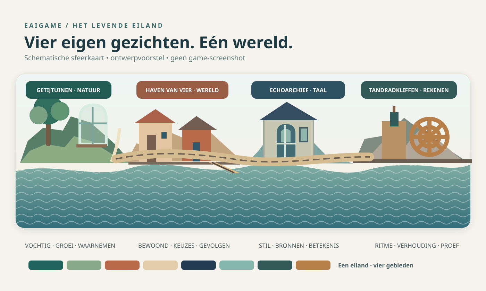
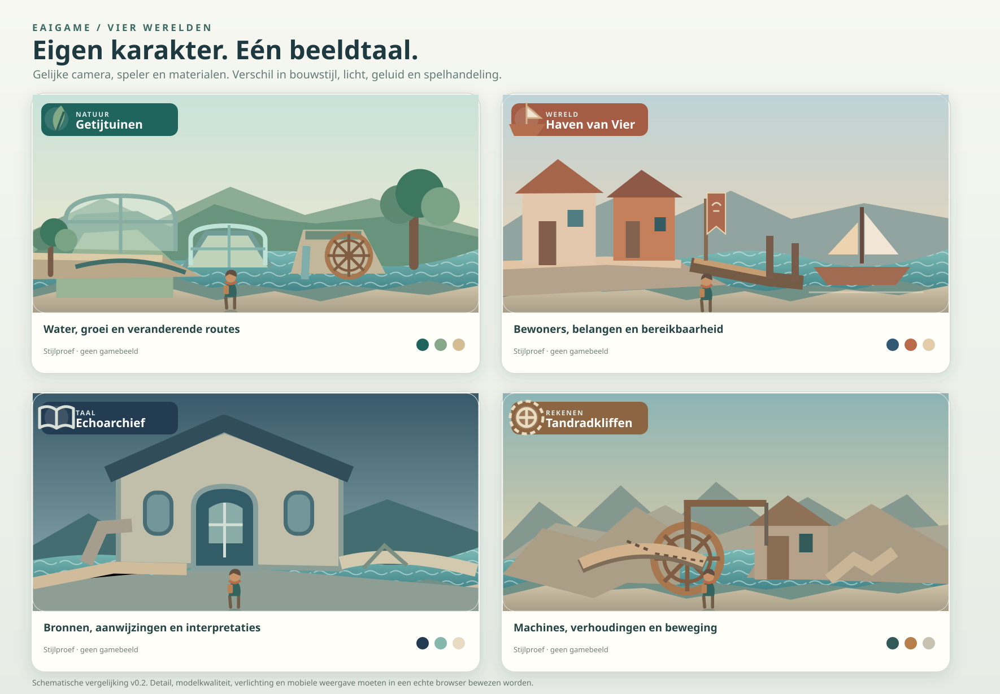

# EAIgame: Het Levende Eiland
**Ontwerpmap, versie 0.1 | 15 november 2026 | ter bespreking**

Dit is de verhaal- en ontwerpbasis voor de volgende EAIgame. De map beschrijft hoe de wereld eruitziet, hoe ze aanvoelt, wat de speler kan doen en wat er verandert door die handelingen. Het is geen bewijs dat de beschreven functies al zijn gebouwd. Deze documenten wijzigen de huidige EAIgame niet.

## Visuele sfeerkaart

[Open de schematische stijlkaart](./sfeerkaart.svg). Dit is een **illustratie van de ontwerprichtingen**, geen gamebeeld of goedgekeurd model. Iedere wijk heeft een ander karakter en palet; het water, de bruggen en de materiaalkeuzes verbinden de wereld.

## Visuele ontwerpstudies

- [Vergelijk de vier gebiedsstijlen](./regio-studies.svg). Identieke kadrering, speler en materiaalafspraken; de omgevingen verschillen in architectuur, sfeer en bedoeling.
- [Bekijk De Storm in drie camerastanden](./camera-studies.svg). Overzicht, achter de speler en onderzoek bij het waterrad.
- [Lees de uitgebreide beeldregie](./beeldregie.md) met concrete materialen, herkenbare plekken, animatiegevolgen en assetzoektermen.

Dit zijn **schematische vectorstudies**, geen 3D-renders of screenshots van een werkende game. De eerder gemaakte AI-sfeerbeelden in de chat zijn inspiratie, niet het technische bewijs dat de gewenste kwaliteit al is bereikt.

## Leesvolgorde
- [De vier regio-studies](./regio-studies.svg): vergelijkende visuele uitwerking van alle gebieden.
- [De drie camerastanden](./camera-studies.svg): storyboardbeelden voor De Storm.
- [De beeldregie](./beeldregie.md): materiaal, belichting, geluid, handeling en zoekprofiel per gebied.
- [Complete onderdeleninventaris](./complete-onderdeleninventaris.md): 3D, personages, effecten, UX, gamecode, onderwijs en tests.
- [Bronregister (JSON)](./bronregister.json): 39 kandidaten met links, bronnen, licentie- en gebruiksstatus.
- [Selectie De Storm](./selectie-de-storm.md): eerste vergelijking, alternatieven, openstaande gaten en importregels.
- [Downloadbesluit en proefset](./downloadbesluit.md): 19 werkelijk opgehaalde modellen, licenties, controle en tijdelijke ZIP.
- [De sfeerkaart](./sfeerkaart.svg): de vier visuele stijlen en hun gedeelde vormtaal.
- [Het verhaal](./verhaal.md): plaats, personages, aanleiding, verhaallijnen, onthulling en mogelijke afloop.
- [Storyboard](./storyboard.md): de eerste veertien speelmomenten, per scène met camera, geluid, bediening en zichtbaar gevolg.
- [Stijl en toon](./stijl-en-toon.md): gedeelde vormgeving, eigen sfeer per gebied, UI, teksten en geluid.
- [Een wereld die blijft bestaan](./wereldregels.md): gebeurtenissen, spelstatus, routekeuzes, opslag, 3D en toetsbare afspraken.
- [Materialen en onderzoek](./materiaal-en-bronnen.md): welke modellen en techniek we zoeken, met een register voor herkomst en licenties.
- [Besluiten en vragen](./besluiten.md): wat is afgesproken, wat is nog een voorstel en wat moet eerst getest worden.

## Voorbereiding vóór het bouwen
We hebben nu een brede inventaris van wat het nieuwe spel vermoedelijk nodig heeft: van glaskas, mechanische brug, wind en water tot veilige opslag, camera en onderwijskundige inhoud. Een **catalogusvermelding is geen gedownloade asset** en geen kwaliteitsgarantie.

Alle geselecteerde bronnen, modellen en UI-voorbeelden moeten op dezelfde stijl, licentie en mobiele prestaties worden getoetst. Grote ruwe bronpakketten blijven buiten de publieke website-repository. We importeren pas kleine goedgekeurde sets voor een echte proef. Zo vermijden we een bulkverzameling die uiteindelijk niet bij de wereld past.

## Richting
EAIgame is geen quiz met een mooi decor. Het is een avonturenwereld waar leren voortkomt uit iets dat de speler wil bereiken: een brug herstellen, informatie controleren, een route openen, een keuze verdedigen of een proef uitvoeren. Het landschap reageert. Spelers kunnen gevolgen terugzien en de wereld later terugvinden.

Het beginpunt is één herkenbaar eiland, met vier kennisgebieden: **Natuur, Wereld, Taal en Rekenen**. Die mogen ieder een eigen kleur, materiaal, architectuur, weersbeeld en ritme krijgen, maar delen dezelfde fysische wereld, gamebediening en visuele kwaliteit. Gebieden liggen naast elkaar, niet achter vier verschillende schermen.

## Reeds besproken versus ontwerpvoorstel
**Afgesproken richting**
- Een wereld zonder zichtbare Monopoly-achtige bordrand of verplichte 32-vakkenlus.
- Een rijk gedetailleerde, gestileerde 3D-uitvoering die in de browser werkt.
- Eigen speelruimte per gebied, in één doorlopende wereld.
- Rustige, herkenbare spelbediening. Het beeld is belangrijker dan de interface.
- Handelingen veroorzaken zichtbare veranderingen. Een goed antwoord alleen is geen spelgebeurtenis.
- De oorspronkelijke Sites-code en PR #277 blijven intact als referentie en terugval.

**Nog niet definitief**
- De namen van de vier locaties, de personages en de volledige verhaallijn.
- De precieze kleurwaarden, 3D-pakketten en de uiteindelijke dichtheid van het detail.
- Alle alternatieve oplossingen, spelbalans, samenwerken en het voltooiingscriterium.
- Het storyboard is een voorstel om goed te keuren, geen al getest spel.

## Ontwerpvolgorde
1. De verhaalwereld en het storyboard beoordelen en bijstellen.
2. Per gebied een kleine stijlstudie met dezelfde camera, belichting en maatvoering.
3. Geschikte openbare modellen en materialen onderzoeken; rechten per bestand vastleggen.
4. Eén werkende scène bouwen: De Storm en de beschadigde brug.
5. Op desktop en mobiel de volledige handeling toetsen, inclusief teruggaan, opslaan, camerawissel, fouten en toegankelijkheid.
6. Pas na een geslaagde proef de rest van de gebieden bouwen.

## Herkomst van de richting
- Oorspronkelijke Sites-baseline: [eaigame-sites-baseline.md](../eaigame-sites-baseline.md).
- Huidige ontwikkelversie: [PR #277](https://github.com/E-AI-MODEL/website/pull/277).
- In de gesprekken gemaakte sfeerbeelden: eerste paarse eiland-moodboard en de latere 3D-briefing met petrol, koper, steen en de kapotte brug. **De afbeeldingen zelf staan nog niet in deze repo.** Ze zijn richtinggevende conceptbeelden, geen screenshots van een werkend spel en geen definitief goedgekeurde modellen.
- Het eerdere register met vijftig verbeterpunten blijft een apart werkregister. Dit ontwerp verklaart die lijst niet ineens voltooid.
