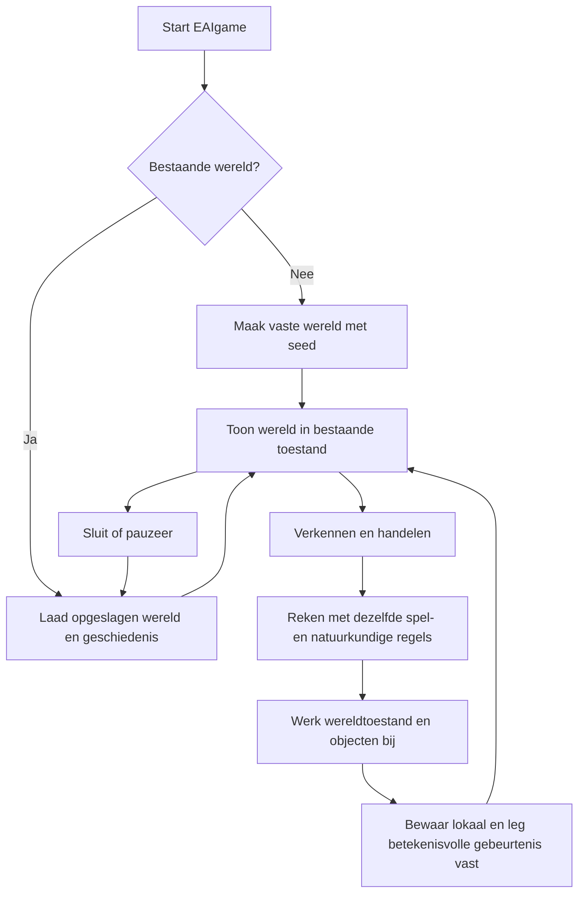

# Een wereld die ontstaat en blijft bestaan
**Versie 0.1 | Functioneel ontwerpvoorstel; nog niet geïmplementeerd**

## De belofte aan de speler
Vanaf het moment dat je EAIgame opent, is er een plek waar al iets gaande is. Een rad draait, de bewoners zijn bezig, het weer trekt voorbij en de brug staat scheef. Je komt niet binnen in een leeg menu dat pas na een vraag een wereld toont.

Spelen verandert die plek. Een schuif die je sluit blijft gesloten. Een herstelde brug blijft bruikbaar. Een keuze voor een omweg heeft gevolgen voor de haven. Kom je later terug, dan herken je de plek én je keuzes.

Dat betekent **geen** onbeperkt draaiende serverwereld als de browser dicht is. In de eerste versie ontstaat de wereld bij het laden uit een opgeslagen toestand; omgeving en animatie lopen verder zolang je speelt. Bij hervatten wordt de toestand hersteld. Een eventueel later ontworpen spelklok moet met duidelijke regels werken, zonder te doen alsof onzichtbaar gebeurtenissen zijn gebeurd.

## Drie lagen

### A. De vaste wereld
Geografie, paden, gebouwen, waterlopen, naamgeving, personages, basisregels en de hoofdlijn van het verhaal staan vast. De speler kan hierop vertrouwen. Een brug is geen andere brug wanneer je terugkomt. Een kanaal springt niet willekeurig naar een andere plek.

### B. Een spelwereld met variatie
Bij de start wordt één `seed` vastgelegd. Hiermee kiezen we uit **vooraf gecontroleerde** variaties zoals het weer, een beginprobleem, welk pad modderig is en waar een aanwijzing ligt. De variatie is reproduceerbaar. De hoofdopdracht moet in iedere variant speelbaar blijven. We genereren niet onbeperkt willekeurige landschappen die het verhaal, de natuurkunde of de routes kunnen breken.

### C. De geschiedenis van deze speler(s)
De wereld bewaart echte handelingen en toestanden: ontdekte aanwijzingen, geteste instellingen, open routes, brugpositie, gekozen omweg, reacties van bewoners en openstaande problemen. Opnieuw een niveau kiezen mag die gegevens niet stilzwijgend wissen.

## Minimale toestanden

| Toestand | Voorbeeld | Zichtbaar gevolg | Controle |
|---|---|---|---|
| `water.level` | 0,63 op genormaliseerde meetschaal | Peilstok en rivier tonen hetzelfde | Meter, water en animatie kloppen |
| `water.gateOpening` | 0,40 | Schuif fysiek verplaatst; waterstroom verandert | Sliders en 3D-model gelijk |
| `wheel.angularSpeed` | Afgeleide grootheid | Draaisnelheid van het rad | Niet handmatig los van model zetten |
| `bridge.angle` | Halfopen / open in graden | Brug beweegt in de scène | Route wordt pas open wanneer veilig |
| `routes.open` | Weg via brug of kade | Kaart en bereikbaarheid veranderen | Geen fictief open pad |
| `clues.observed` | Peil, kabel, archiefkaart | Speler kan gevonden bewijs terugzien | Herkomst blijft bewaard |
| `residents.concerns` | Toegankelijkheid, doorvaart | Dialoog en gedrag bij de haven veranderen | Geen gefingeerde tevredenheid |
| `repairs.completed` | Lagering nagekeken | Onderdeel krijgt nieuwe toestand | Blijft zichtbaar na hervatten |
| `quest.status` | 'bridge-testable' | Nieuwe handeling verschijnt | Geen inconsistent verhaal |
| `world.ending` | Snel / omweg / samen | Laatste scène en open problemen verschillen | Meer dan tekstuele keuze |

Concrete schaalwaarden en formules zijn **nog te valideren**. Een numerieke voorbeeldwaarde is geen natuurkundig geijkte meting.

## Ontstaan en voortbestaan



## Technisch voorstel voor opslag
We bewaren de kleinste **betekenisvolle toestand**, niet iedere framestap. Animatie wordt uit die toestand opnieuw opgebouwd. Een versieveld maakt migraties mogelijk.

```json
{
  "schemaVersion": 1,
  "worldId": "local-world-01",
  "seed": "voorbeeld-seed-v1",
  "startedAt": "2026-11-15T00:00:00.000Z",
  "savedAt": "2026-11-15T00:00:00.000Z",
  "setting": "after-storm",
  "players": [{"id": "player-1", "level": "havo", "at": "steiger"}],
  "world": {
    "water": {"gateOpening": 0.4, "level": 0.63},
    "bridge": {"angle": 35, "checked": false},
    "routes": {"oldBridge": false, "quayDetour": true},
    "clues": {"observed": ["watermark"]},
    "repairs": {"bearing": "uninspected"},
    "ending": null
  },
  "events": [
    {"id":"e1","kind":"clue-observed","subject":"watermark"}
  ]
}
```

Dit is een **voorstel voor de toekomstige datastructuur**, geen werkende import/export-indeling. Het voegt nog niets toe aan de bestaande localStorage-schema's van PR #277. We nemen geen leerlingnamen of gesprekstranscripten op in de standaardopslag. Spelgeschiedenis is lokaal en door de gebruiker te wissen/exporteren. Voor spelen op verschillende apparaten of met kamercodes zijn extra afspraken over accounts en persoonsgegevens nodig.

### Eerste implementatie
- Versienummer en lokale save-slot per wereld.
- Wereldseed één keer genereren, daarna bewaren.
- Betekenisvolle acties als compacte eventregel opslaan met een eigen ID, type en betrokken object.
- De laatste vertrouwde wereldtoestand opslaan en bij openen valideren.
- Bij ontbrekende of beschadigde opslag niet destructief overschrijven. Toon een veilige keuze om terug te gaan of een kopie te importeren.
- Historie en snapshot moeten bij elkaar passen. Geen dubbele gebeurtenis door opnieuw tekenen van een frame.
- Iedere opgeslagen overgang is te testen zonder 3D-renderer. De 3D-laag toont de uitkomst, maar **bepaalt nooit zelf** of de brug geopend is.

## Spelregels die elkaar niet mogen tegenspreken
- Een pad is fysiek bereikbaar of niet; de kaart en de camera gebruiken dezelfde gegevens.
- Bij een tussenstand moet de speler een openstaande handeling kunnen afmaken of veilig verlaten.
- Een verkeerde proef veroorzaakt een begrijpelijk, herstelbaar gevolg, geen willekeurig verlies van voortgang.
- Spelerinformatie verandert de wereld alleen via een duidelijke handeling, nooit automatisch op basis van ongecontroleerde AI-tekst.
- Grote veranderingen zijn zichtbaar in minstens twee plekken: het object en zijn omgeving/route/andere personages.
- Een veranderende wereld is niet altijd een **betere** wereld. De waarde van een keuze wordt getoond via concrete gevolgen, niet een verborgen moraliteitsscore.
- De start blijft bereikbaar; variaties of gemaakte keuzes mogen geen onoplosbare toestand creëren.
- Het verhaal mag vertakken, maar bewijsmateriaal blijft hetzelfde bewijs en krijgt geen nieuwe inhoud om een gekozen plot te rechtvaardigen.

## Omgaan met tijd
De eerste speelversie gebruikt lokale **speltijd**, gekoppeld aan uitgevoerde gebeurtenissen. Geen belofte dat een brug uit zichzelf verder gerepareerd wordt terwijl iemand offline is. Later kan een expliciete kalender of dag-nachtwisseling worden toegevoegd, maar een offline wereld mag geen schijnbaar autonome server voorstellen.

## Spelen met meer deelnemers
Voor nu op één apparaat. Spelers kunnen samen beslissen en ieder een eigen route of idee onderzoeken, maar er bestaat één gedeelde wereldtoestand. Een tweede apparaat mag niet onzichtbaar een concurrerende wereld aanpassen. Echt online samenspelen vraagt serverauthoriteit, synchronisatie en toegangsbeheer en is een afzonderlijk ontwerpbesluit.

## Onderwijskundige logica
- Een speler moet waar zinvol **voorspellen, ingrijpen, waarnemen en verklaren**.
- Niet iedere situatie hoeft een toets te zijn. Soms is het ontdekken van een detail voldoende om verder te kunnen.
- Een vraag kan terugkomen in een andere situatie; die nieuwe context moet inhoudelijk verschillen.
- De drie schoolniveaus krijgen elk eigen handelingen, bronverwijzingen en vastgelegde redactionele status.
- Punten en een fraaie uitkomst zijn geen bewijs van zelfstandig leren, onthouden of toepassen op een nieuwe taak.
- Opdrachten en modellen vereisen een inhoudelijke controle vóór gebruik als leermiddel.

## Tests vóór een claim dat deze wereld werkt
1. Nieuwe wereld start consistent vanaf dezelfde seed, inclusief bordloze kaart en speelbare route.
2. Speler wijzigt waterinstelling; animatie, meting, brug en route volgen dezelfde toestand.
3. Speler maakt een fout, ziet een herstelbaar gevolg en kan opnieuw handelen.
4. Speler verlaat de pagina midden in een opdracht en hervat zonder dubbele handelingen.
5. Na herladen staan brug, water, gesprek en kaart nog in dezelfde toestand.
6. Twee spelers delen een scène zonder samen te vallen of elkaars toestand te overschrijven.
7. Een mobiel zonder snelle WebGL blijft bruikbaar met beperkte effecten; voortgang gaat niet verloren.
8. Alle toestanden hebben een verklaarbare oorzaak. Andere routes blijven logisch bereikbaar.
9. Opslag is versieerbaar; een update wist geen bestaande save.
10. Alle nieuwe inhoud is herkenbaar als redactioneel gecontroleerd of als concept.

**Status: ontwerpdocument. Er is nog geen gameplaycode of opslag voor deze nieuwe wereld gebouwd.**
